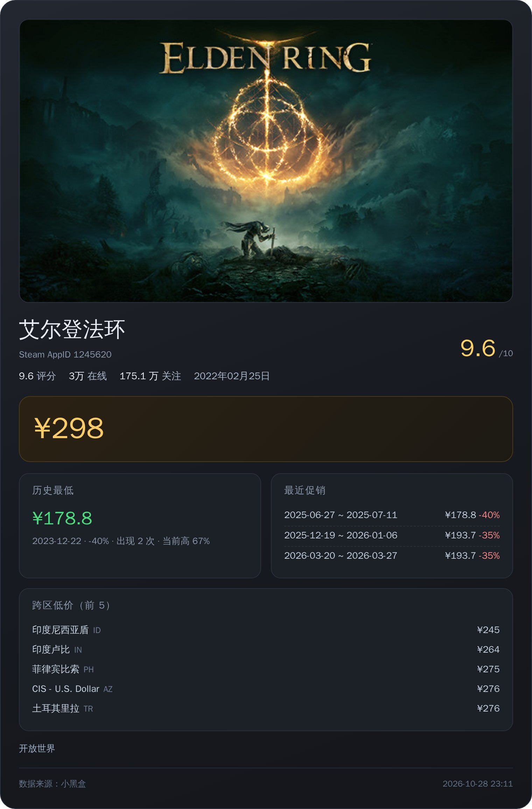

# astrbot_plugin_heybox_game

小黑盒游戏卡片插件：输入**游戏名 / appid / 小黑盒或 Steam 游戏链接**，抓取小黑盒数据并绘制成一张卡片图片。



## 功能

| 能力 | 说明 |
| --- | --- |
| 游戏搜索 | 中文名直接搜，自动挑最匹配的一个 |
| 价格 | 当前价 / 原价 / 折扣 |
| 历史最低 | 史低价、日期、折扣、出现次数、当前比史低高多少 |
| 促销历史 | 最近 3 次促销的时间区间与折扣 |
| 跨区比价 | 折算人民币后最便宜的若干区服 |
| 游戏信息 | 评分、在线人数、关注数、发售日期、分类标签、封面 |
| 链接解析 | 只认游戏链接：`xiaoheihe.cn/app/topic/game/pc/<appid>`、`store.steampowered.com/app/<appid>`；其它链接一律不处理 |
| 扫码登录 | 内置小黑盒扫码登录，登录态保存在插件数据目录 |
| Cookie 配置 | 也可以直接在插件配置里填 cookie |

## 安装

1. 把仓库整个目录放到 AstrBot 的 `data/plugins/` 下（目录名 `astrbot_plugin_heybox_game`）
2. 重启 AstrBot

依赖全部由 AstrBot 核心提供（`aiohttp` / `Pillow` / `qrcode` / `playwright`），无需额外安装。
图片渲染使用 playwright + chromium，若提示找不到浏览器：

```bash
python -m playwright install chromium
```

## 使用

```
/小黑盒 赛博朋克2077
/小黑盒 1091500
/小黑盒 https://www.xiaoheihe.cn/app/topic/game/pc/1245620
/小黑盒 https://store.steampowered.com/app/730/
```

别名：`/xhh`、`/游戏价格`、`/steamprice`、`/查价`

其它命令：

```
/小黑盒登录    # 扫码登录（默认仅管理员）
/小黑盒状态    # 查看 cookie 状态
```

## 配置

`_conf_schema.json` 里的字段：

| 字段 | 默认 | 说明 |
| --- | --- | --- |
| `cookies` | 空 | 形如 `user_pkey=xxx; heybox_id=123`，留空则只用公开数据 |
| `days` | 720 | 历史价格回溯天数 |
| `max_regions` | 5 | 跨区比价显示数量 |
| `timeout` | 20 | 请求超时（秒） |
| `render_width` | 760 | 卡片宽度（像素） |
| `admin_only_login` | true | 仅管理员可触发扫码登录 |

cookie 优先级：配置里的 `cookies` > 扫码登录保存的 `credentials.json`。

## 数据来源

小黑盒公开接口：

- `/game/search/` 搜索（appid、名称、价格、评分、在线、关注、标签、封面）
- `/game/get_game_prices/history/v2` 历史价格与史低（注意 `cc` 必须小写 `cn`）
- `/game/get_game_global_prices/` 跨区价格

## 已知限制

- 小黑盒接口可能变动，`cc` 之类的大小写敏感参数会导致返回空数据
- 渲染依赖 playwright + chromium，首次渲染约 2~4 秒
- 只解析游戏链接；帖子、评测等其它小黑盒链接不处理
