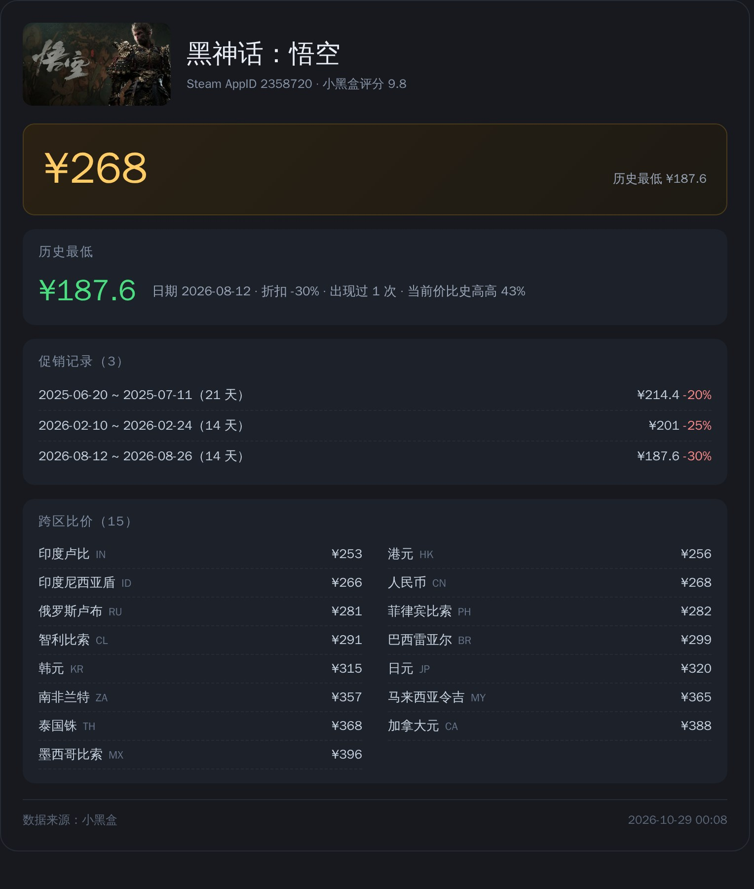

# astrbot_plugin_heybox_game

小黑盒游戏卡片插件 —— 输入**游戏名 / appid / 小黑盒或 Steam 游戏链接**，抓取小黑盒数据并绘制成卡片图片。

提供两张卡片：

| 命令 | 卡片 | 内容 |
| --- | --- | --- |
| `/小黑盒 <游戏>` | 游戏详情卡 | 封面、价格、评分、标签、数据格、发布信息、价格摘要、配置要求、简介 |
| `/小黑盒价格 <游戏>` | 价格详卡 | 当前价、史低、促销记录（完整）、跨区比价（完整） |

## 游戏详情卡


## 价格详卡



## 功能与数据来源

| 信息 | 来源 | 说明 |
| --- | --- | --- |
| 封面 / 中英文名 | 详情接口 | 16:9 大图 |
| 价格 / 原价 / 折扣 | 详情接口 | 当前价、原价、折扣百分比 |
| 评分 / 评分人数 | 详情接口 | 橙色评分徽章 |
| 平台 / 标签 | 详情接口 | Steam/Epic/Xbox/PSN + 分类标签 |
| 数据格 | 详情接口 `user_num` | 当前在线、史低、好评率、峰值、销量、玩家数、时长（空值自动隐藏） |
| 发布时间 / 开发商 / 发行商 | 详情接口 `menu_v2` | 与小黑盒页面一致 |
| 配置要求 | 硬件配置接口 | 最低 / 推荐，完整内容，左右两列、列内再分两栏 |
| 游戏简介 | 详情接口 | 默认 400 字 |
| 历史最低价 | 历史价格接口 | 价格、日期、折扣、出现次数、当前高多少 |
| 促销记录 | 历史价格接口 | 游戏卡显示最近 3 条，价格卡显示最近 8 条 |
| 跨区价格 | 跨区接口 | 游戏卡显示 5 个，价格卡显示 15 个 |

## 输入格式

```
/小黑盒 赛博朋克2077
/小黑盒 1091500
/小黑盒 https://www.xiaoheihe.cn/app/topic/game/pc/1245620
/小黑盒 https://store.steampowered.com/app/730/
```

别名：

- 游戏卡：`/xhh`、`/游戏`
- 价格卡：`/steamprice`、`/查价`、`/价格`、`/xhh价格`

只处理游戏相关输入，其它链接一律不响应。

## 扫码登录

```
/小黑盒登录     # 管理员可触发，用小黑盒 APP 扫码
/小黑盒状态     # 查看 cookie 状态
```

凭证保存在 `data/plugin_data/astrbot_plugin_heybox_game/credentials.json`。

## 安装

把仓库目录放到 `data/plugins/astrbot_plugin_heybox_game/`，重启 AstrBot。

依赖由 AstrBot 核心提供：`aiohttp`、`Pillow`、`qrcode`、`playwright`。
若提示找不到浏览器：`python -m playwright install chromium`。

## 配置项

| 字段 | 类型 | 默认 | 说明 |
| --- | --- | --- | --- |
| `cookies` | text | 空 | `user_pkey=xxx; heybox_id=123`，留空用扫码保存的凭证 |
| `req_mode` | select | full | full-完整内容（默认，列内两栏排版）；compact-只显示处理器/内存/显卡/存储；off-不显示 |
| `show_requirements` | bool | true | 显示配置要求 |
| `intro_length` | int | 400 | 简介字数，0 = 不显示 |
| `max_tags` | int | 8 | 标签数量 |
| `days` | int | 720 | 历史价格回溯天数 |
| `max_regions` | int | 5 | 游戏卡的跨区数量 |
| `price_max_regions` | int | 15 | 价格卡的跨区数量 |
| `price_sales_limit` | int | 8 | 价格卡的促销记录条数 |
| `timeout` | int | 20 | 小黑盒请求超时 |
| `render_width` | int | 760 | 卡片宽度 |
| `render_scale` | float | 2.0 | 渲染倍率 |
| `cache_keep_seconds` | int | 3600 | 图片保留时长 |
| `admin_only_login` | bool | true | 仅管理员可扫码登录 |
| `steam_requirements` | bool | false | Steam 兜底（需代理，默认关闭） |
| `requirements_timeout` | float | 4.0 | Steam 兜底超时 |
| `proxy` | string | 空 | 仅 Steam 兜底时使用 |

### cookie 优先级

```
配置里的 cookies  >  credentials.json（扫码登录保存）  >  无（仅公开数据）
```

## 数据来源接口

| 接口 | 用途 |
| --- | --- |
| `/game/search/` | 名称搜索、appid 定位 |
| `/game/get_game_detail/` | 详情（需签名 `_time` + `nonce` + `hkey`） |
| `/game/get_game_prices/history/v2` | 历史价格与史低（`cc` 必须小写 `cn`） |
| `/game/get_game_global_prices/` | 跨区价格 |
| `/pc/get_game_hardware_performance_board/` | 配置要求（最低 / 推荐） |

签名算法与扫码登录实现在 `core/login.py`，来源见文件头注释。

## 常见问题

**Q：在线趋势没有数值**
A：小黑盒详情接口对该字段返回 `-`，需要客户端上下文才计算，插件会自动隐藏空数据格。

**Q：配置要求为空**
A：部分小游戏在硬件配置接口里没有收录，显示"暂无数据"。

**Q：cookie 失效**
A：重新 `/小黑盒登录` 扫码，或直接在配置里填新的 `cookies`。

**Q：搜不到游戏**
A：小黑盒搜索按中文名匹配，可直接用 appid 或 Steam 链接。

## 免责声明

数据来自小黑盒公开接口，仅供个人查询使用。